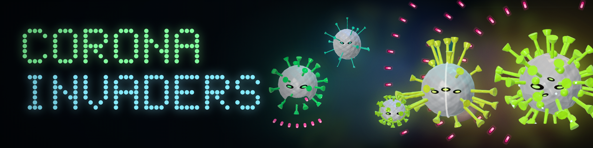
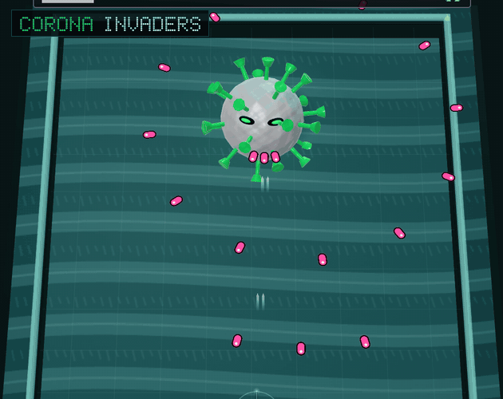
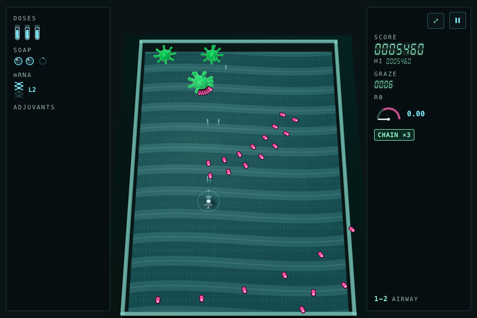
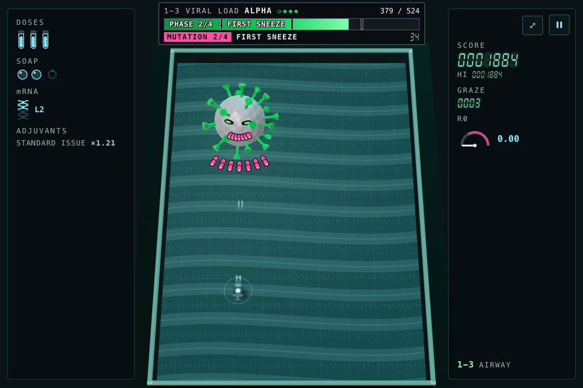
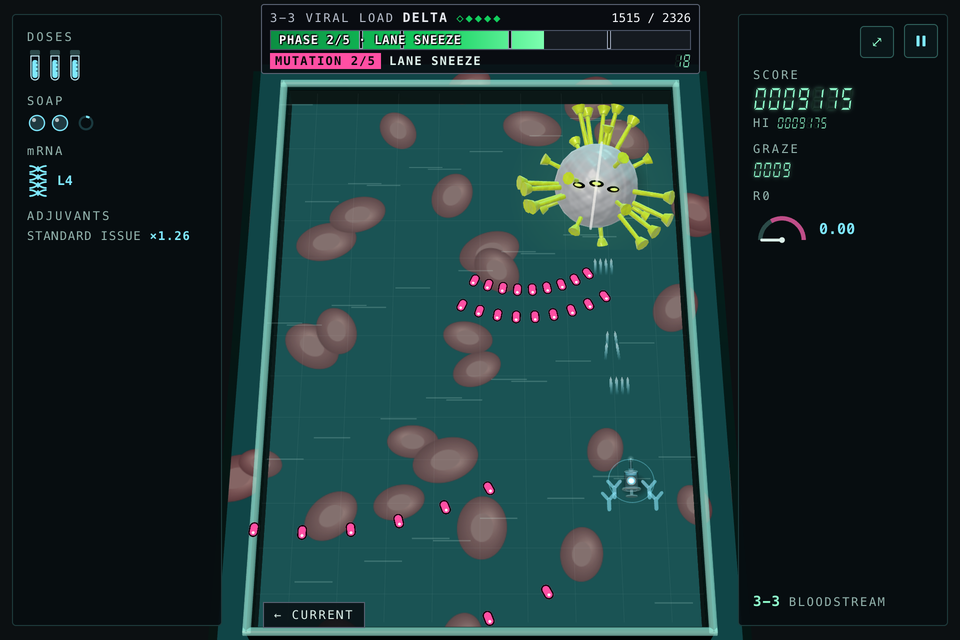
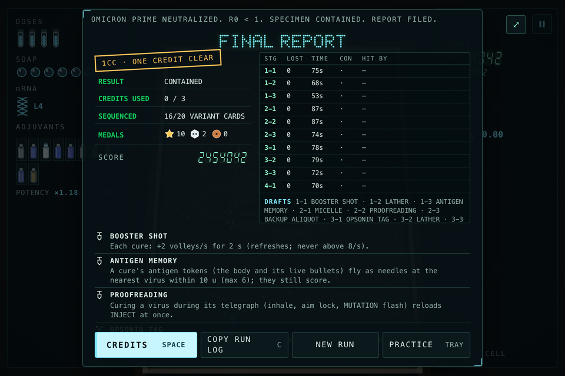

<h1 align="center"></h1>

<div align="center">

**ERRADICATE TEH CORONA**

You are a vaccine syringe in a bullet hell in real 3D.<br>
Twelve stages, four sectors, four bosses. Dodge, graze, stab the viruses with your needle.

[](https://caucau.itch.io/corona-invaders)


</div>

---

Turn the sound on and run. You can play it right now in your browser, no install, at **[caucau.itch.io/corona-invaders](https://caucau.itch.io/corona-invaders)**. This repository is the source.

<p align="center">
  
</p>

## About

A bullet hell in a real 3D scene, rebuilt from Cauê Melo's Corona Invaders (Canvas Retro Arcade, 2023). A run is twelve stages in four sectors, each one deeper into the body: **AIRWAY**, **LUNGS**, **BLOODSTREAM** and **THE CELL**. Each sector moves differently. In the lungs the bullets slow on the inhale and rush on the exhale. In the bloodstream a current carries every bullet. In the cell the viruses mutate. Each sector ends with a boss: **ALPHA**, **BETA & GAMMA**, **DELTA** and **OMICRON PRIME**.

What makes it different:

- **The hitbox is what you see.** Only the glowing dose in the barrel is solid. The rest of the syringe, and the spikes on every virus, cannot hurt you or be hurt. Bullets that brush past the ring around it are grazes: they score and fill the bar toward your next SOAP.
- **Touch a virus with the needle tip and it is cured at once.** It scores double and its bullets turn into tokens. Only the tip counts.
- **Formulate between stages.** After each stage you pick one of three ADJUVANTS. There are 30 in four tiers, and beating a boss improves the offer. Your build lasts for the run.
- **Three credits.** Losing your last vial spends one and restarts the stage you lost. Clear the run on one credit for the 1CC stamp.
- **You choose the difficulty.** Easy has five vials, three SOAP, an automatic SOAP when you are hit and fewer, slower bullets. Normal is the designed game. Hard has more bullets and fewer chances. A game-speed assist slows everything to 90, 80 or 70 per cent. After three losses the game offers an extra vial or Easy.
- **A run has a beginning and an end.** A new run opens with a five-line lab briefing. Beat OMICRON PRIME and a short epilogue plays, then the FINAL REPORT, then seven calm credit cards that end on the title.
- **The reports are written in a calm lab voice:** a LAB REPORT after each sample, a FIELD NOTE after each boss.

## Controls

Fire is automatic.

| Key | Action |
| --- | --- |
| Arrows or `W` `A` `S` `D` | Move. You can also hold the left mouse button over the board and the syringe follows the cursor. |
| `Shift` | Focus: slower, with a tight needle stream, and the graze ring shows. |
| `Space` or `X` | SOAP, the bomb. |
| `P` or `Esc` | Pause. |
| `R` | Restart the sample. |

## Screenshots

<table>
  <tr>
    <td width="50%"></td>
    <td width="50%"></td>
  </tr>
  <tr>
    <td align="center"><sub>1-2 · AIRWAY</sub></td>
    <td align="center"><sub>1-3 · ALPHA</sub></td>
  </tr>
  <tr>
    <td width="50%"></td>
    <td width="50%"></td>
  </tr>
  <tr>
    <td align="center"><sub>DELTA, in the BLOODSTREAM</sub></td>
    <td align="center"><sub>The FINAL REPORT</sub></td>
  </tr>
</table>

## Run it locally

You need Node.js 18 or newer and a browser with WebGL2. Nothing to install: three.js is in `vendor/`. The game loads ES modules, so it has to be served over HTTP, and `npm run dev` does that.

```sh
git clone https://github.com/cauesmelo/corona-invaders.git
cd corona-invaders
npm run dev          # then open http://127.0.0.1:4175
npm test             # simulation, patterns, cards, movement, audio, credits and release checks
npm run build:itch   # writes dist/corona-invaders-itch.zip, the file uploaded to itch.io
```

No CDN, account or backend. No font, image, model or sound is downloaded while you play.

## How it is built

Plain JavaScript with ES modules and [three.js](https://threejs.org) r187 (vendored, MIT). The 3D scene is a real perspective view of a tilted board, not a 2D game with 3D art pasted on.

- The simulation is pure. It imports neither the DOM nor three.js, and it steps at no more than 1/120 s, so the same inputs give the same run at any frame rate. Collisions are swept over each step.
- Every collider is one shared module (`hitboxes.mjs`) used by both the simulation and the renderer, which is how "the hitbox is what you see" stays true.
- Every shape and texture is drawn in code, and the lettering is dot-matrix SVG. The game ships no image, model or font files.
- Sound is synthesised live with the Web Audio API. There are no recordings.
- Bullet density, speeds and the cards were tuned with bots and a player with a fixed reaction time, then checked in a real browser with real key presses.

## Documentation

- [DEVELOPMENT.md](DEVELOPMENT.md): the full engineering notes (code map, UI, sound, villains, validation)
- [LEVEL_DESIGN.md](LEVEL_DESIGN.md), [BALANCE.md](BALANCE.md) (numbers and measured evidence), [MOVEMENT_AUDIT.md](MOVEMENT_AUDIT.md)
- [CHANGELOG.md](CHANGELOG.md) and [ITCH_IO.md](ITCH_IO.md) (the export notes)
- Design briefs: [RESEARCH.md](RESEARCH.md), [RESEARCH_V1.md](RESEARCH_V1.md), [RESEARCH_BULLET_HELL.md](RESEARCH_BULLET_HELL.md), [RESEARCH_CARDS.md](RESEARCH_CARDS.md), [RESEARCH_DIFFICULTY.md](RESEARCH_DIFFICULTY.md)

## Status

- It needs WebGL2. If your browser does not have it, the game says so.
- Tested in Chrome, with software rendering. Firefox, Safari and real phones have not been tried, and the frame rate on a slow GPU is unmeasured.
- The difficulty was tuned with test players, not with many people. Normal may be too hard or too easy for you. The title has a difficulty switch, and the run-over screen has a button that copies a log of your run to paste into a comment.
- The sound is synthesised and has been measured, not tuned by ear.
- The coronaviruses are cartoons. Nothing here is medical information or says anything real about vaccines.

## Credits

- **Original game:** Corona Invaders by Cauê Melo, part of Canvas Retro Arcade, 2023, MIT licence. The 16x16 corona and syringe sprites come from that game.
- **This version:** Corona Invaders 3D v1.0 is a bullet-hell remake for Cauê Melo, developed with AI assistance (Claude Code).
- **3D:** [three.js](https://threejs.org) r187 by the three.js authors, MIT licence (`vendor/THREE-LICENSE.txt`).
- **Sound:** every sound and the music are synthesised live with the Web Audio API, with no recordings. The four-note march is a nod to Space Invaders (Tomohiro Nishikado, Taito, 1978).
- **Lettering:** the dot-matrix lettering, every 3D shape and every texture are drawn in code. The only typeface is the system monospace.

This repository has no licence file yet.
